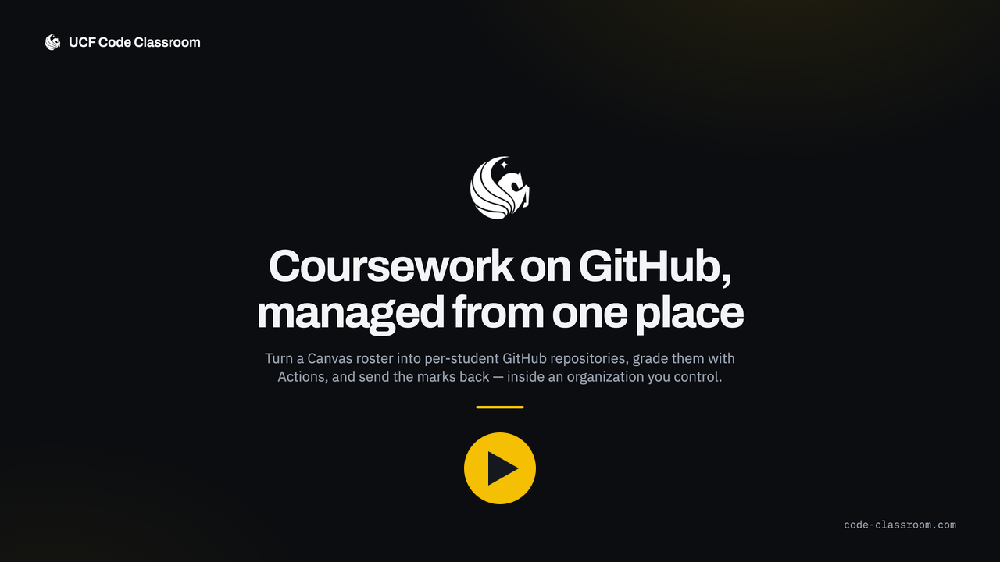

# UCF Code Classroom

[](https://github.com/kpmoran/UCF-Code-Classroom/actions/workflows/ci.yml)
[](https://kpmoran.com/UCF-Code-Classroom/)

A self-hosted GitHub Classroom replacement for UCF courses.

The app is an **orchestration layer over a real GitHub organization**. It owns the
course-shaped concepts GitHub has no notion of — classrooms, rosters, assignments,
teams, deadlines, grades — and drives the GitHub REST API to materialize them as
repositories, teams, and collaborator invitations. Students work in real GitHub
repos, with real Actions and real pull requests.

**Documentation: <https://kpmoran.com/UCF-Code-Classroom/>** — setup, deployment,
and the design notes behind each feature. The source is in [`docs/`](docs/).

## A 30-second tour

[](https://code-classroom.com)

Roster import through to grade export, with real screenshots of the running app. It also
plays on the [front page](https://code-classroom.com); the file itself is
[`public/promo.mp4`](public/promo.mp4), and `promo/` holds the sources and the script
that rebuilds it.

## How it fits together

One Docker Compose stack — a Next.js container, Postgres, Caddy for TLS — plus a GitHub
organization you own. There is no separate worker service and no Redis: the job queue is
[pg-boss], so it is tables in the same Postgres, and the worker runs inside the Next.js
process.

Everything that touches GitHub goes through that queue, behind a rate limiter, and the
pages show its progress rather than waiting on it. Autograding results are pulled from
Actions artifacts rather than pushed by the student's repository, so grading survives the
app being offline or changing its domain. Canvas is a gradebook CSV out and a gradebook
CSV in — no API credentials. The [architecture overview][arch] has the diagram.

[pg-boss]: https://github.com/timgit/pg-boss
[arch]: https://kpmoran.com/UCF-Code-Classroom/#overview-of-the-code-classroom-architecture

## Features

- Classrooms per course, backed by a GitHub organization
- Student self-registration via an invite link and roster self-identification
- Students become organization members when they join, so repositories are granted
  directly instead of through per-repository invitations that expire
- Assignments generated from template repositories, or starting from an empty repository
- Individual **and** group (team) assignments, either creating repositories or adopting
  ones that already exist — including several students sharing one repository
- Canvas roster import from a Gradebook CSV export, plus adding students one at a time
- Instructor console for classroom settings and membership management
- Faculty invitations, so only invited colleagues can create classrooms
- Deadlines with per-student and per-team extensions
- Autograding via GitHub Actions
- Feedback pull requests
- Grade export back to Canvas
- Light and dark themes, following the system setting or an explicit choice

## Stack

Next.js 16 (App Router) · TypeScript · Postgres 16 · Prisma 7 · Auth.js v5 ·
Octokit · pg-boss · Tailwind 4 · Vitest · Playwright

## Quick start

```bash
# 1. Install dependencies
npm install

# 2. Configure environment
cp .env.example .env
# Generate the three secrets and paste them in:
openssl rand -base64 32   # AUTH_SECRET
openssl rand -base64 32   # ENCRYPTION_KEY  (must be exactly 32 bytes)
openssl rand -hex 32      # GITHUB_WEBHOOK_SECRET

# 3. Start Postgres (Docker Desktop must be running)
npm run db:up

# 4. Apply migrations and load development data
npm run db:deploy
npm run db:seed

# 5. Run
npm run dev
```

The app boots without GitHub credentials so you can work on the UI, but anything that
touches GitHub will fail with a clear message until you complete the
[GitHub App setup](https://kpmoran.com/UCF-Code-Classroom/getting-started/github-app/).

## Where to go next

| If you want to… | Read |
|---|---|
| Register the GitHub App and install it on your organization | [GitHub App setup](https://kpmoran.com/UCF-Code-Classroom/getting-started/github-app/) |
| Understand who can sign in, create classrooms, or administer the site | [Sign-in, faculty and site admins](https://kpmoran.com/UCF-Code-Classroom/access/sign-in-and-roles/) |
| Set assignments, deadlines, and team or existing-repository work | [Using it](https://kpmoran.com/UCF-Code-Classroom/guide/assignments/) |
| Put it on a server | [Deploying](https://kpmoran.com/UCF-Code-Classroom/deployment/deploying/) |
| Run the tests, or change the code | [Development](https://kpmoran.com/UCF-Code-Classroom/development/commands/) |

The docs are plain Markdown under [`docs/`](docs/), so they read fine on GitHub too.
To preview the site locally, `npm run docs` (needs [`uv`](https://docs.astral.sh/uv/)).

## License

[MIT](LICENSE). The UCF Pegasus mark in `public/` is a University of Central Florida
trademark and is not covered by that licence; the promo soundtrack is *Dopamine* by KV,
used under its own terms — see [`promo/README.md`](promo/README.md).
