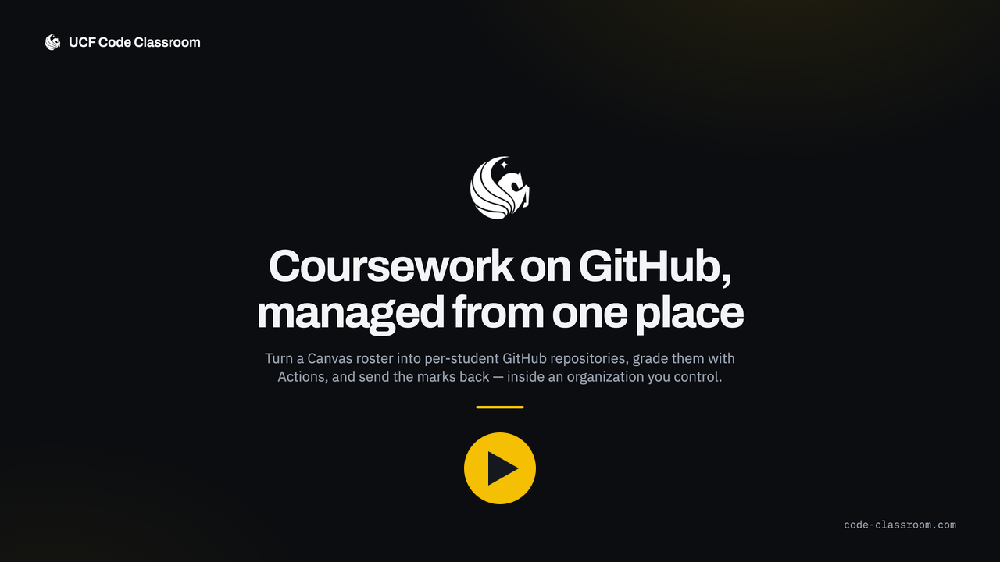
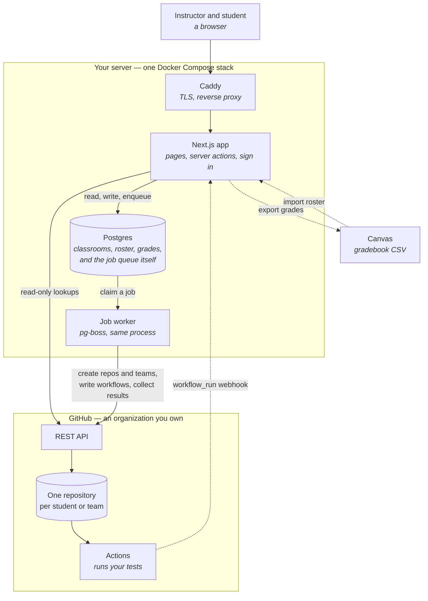

# UCF Code Classroom

A self-hosted GitHub Classroom replacement for UCF courses.

The app is an **orchestration layer over a real GitHub organization**. It owns the
course-shaped concepts GitHub has no notion of — classrooms, rosters, assignments,
teams, deadlines, grades — and drives the GitHub REST API to materialize them as
repositories, teams, and collaborator invitations. Students work in real GitHub
repos, with real Actions and real pull requests.

## A 30-second tour

Roster import through to grade export, with real screenshots of the running app. It also
plays on the [front page](https://code-classroom.com); the file itself is
[`public/promo.mp4`](https://github.com/kpmoran/UCF-Code-Classroom/blob/main/public/promo.mp4), and `promo/` holds the sources and the script
that rebuilds it.

## Overview of the Code Classroom Architecture

The whole thing is one Docker Compose stack — a Next.js container, Postgres, Caddy for
TLS — plus a GitHub organization you own. There is no separate worker service and no
Redis: the job queue is [pg-boss], so it is tables in the same Postgres, and the worker
runs inside the Next.js process, started from `src/instrumentation.ts`.

Two edges in that picture carry most of the design.

**Everything that touches GitHub goes through the queue.** Generating a repository and
inviting a student is two API calls each, and GitHub allows 80 content-creating requests
a minute, so provisioning a 200-student assignment is inherently a background job with a
rate limiter in front of it. The pages never wait on it; they show its progress.

**Results are pulled, not pushed.** The autograding workflow uploads its results as a
build artifact and the app fetches them, rather than the student's repository calling
home. Grading therefore survives the app being offline, moving domain, or changing its
name — all three of which have happened to this instance.

Canvas is the one hop that is deliberately manual: a gradebook CSV out, a gradebook CSV
in. No API credentials, no integration to get approved, and the identity columns come
back exactly as Canvas issued them.

[pg-boss]: https://github.com/timgit/pg-boss

## Features

- Classrooms per course, backed by a GitHub organization
- Student self-registration via an invite link and roster self-identification
- Students become organization members when they join, so repositories are granted
  directly instead of through per-repository invitations that expire
- Assignments generated from template repositories
- Individual **and** group (team) assignments, either creating repositories or adopting
  ones that already exist — including several students sharing one repository
- Canvas roster import from a Gradebook CSV export, plus adding students one at a time
- Instructor console for classroom settings and membership management
- Faculty invitations, so only invited colleagues can create classrooms
- Deadlines with per-student and per-team extensions
- Autograding via GitHub Actions
- Feedback pull requests
- Grade export back to Canvas
- Light and dark themes, following the system setting or an explicit choice

## Stack

Next.js 16 (App Router) · TypeScript · Postgres 16 · Prisma 7 · Auth.js v5 ·
Octokit · pg-boss · Tailwind 4 · Vitest · Playwright

## Where to go next

| If you want to… | Read |
|---|---|
| Run it on your machine | [Quick start](getting-started/quick-start.md) |
| Register the GitHub App and install it on your organization | [GitHub App setup](getting-started/github-app.md) |
| Understand who can sign in, create classrooms, or administer the site | [Sign-in, faculty and site admins](access/sign-in-and-roles.md) |
| Set assignments, deadlines, and team or existing-repository work | [Assignments and repositories](guide/assignments.md) |
| Put it on a server | [Deploying](deployment/deploying.md) |
| Change the code | [Commands and project layout](development/commands.md) |
